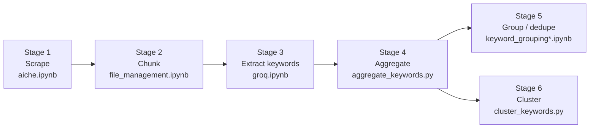

# AIChE Keyword Trend Analysis — Project Report

A pipeline that scrapes AIChE conference abstracts, extracts chemical-engineering keywords with an LLM, and clusters them into research themes for trend analysis for chemical engineering.

This document is the full narrative: what was built, what was tried and rejected, every algorithm in detail, and what the results actually look like. For a terser, machine-maintained map of the repo (kept current automatically), see [`context/`](context/).

---

## Table of contents

1. [Repository structure](#1-repository-structure)
2. [Pipeline overview](#2-pipeline-overview)
3. [Stage 1 — Scraping](#3-stage-1--scraping)
4. [Stage 2 — Chunking](#4-stage-2--chunking)
5. [Stage 3 — Keyword extraction](#5-stage-3--keyword-extraction)
6. [Stage 4 — Aggregation](#6-stage-4--aggregation)
7. [Stage 5 — Grouping / deduplication](#7-stage-5--grouping--deduplication)
8. [Stage 6 — Clustering](#8-stage-6--clustering)
9. [Correctness validation](#9-correctness-validation)
10. [Algorithm comparison: why Ward, not the alternatives](#10-algorithm-comparison-why-ward-not-the-alternatives)
11. [Real results](#11-real-results)
12. [Honest flaws and limitations](#12-honest-flaws-and-limitations)
13. [Infrastructure notes](#13-infrastructure-notes)
14. [What's left](#14-whats-left)

---

## 1. Repository structure

The repo is organized by pipeline stage — each topic folder holds both the code for that stage and the data it produces.

```
01_scraping/
├── aiche.ipynb              Selenium + BeautifulSoup scraper for aiche.confex.com
├── raw/                     Stage-1 output: aiche_file*, 2016/, sessions/, presentation_links/
└── chunked/                 Stage-2 output: aiche_file*_output/ (80-record chunks)

02_extraction/
├── aggregate_keywords.py    Combines every groq/extracted_results* folder into aggregate.json
├── keyword_processor.ipynb  Older single-folder aggregator (superseded by the script above)
├── extracted/                Legacy alt-naming Stage-3 output (pre-dates groq/ convention)
└── aggregate.json            The consolidated keyword database — every stage after this reads it

03_grouping/
├── keyword_grouping.ipynb    Rule-based + Ollama semantic dedup, v1
├── keyword_grouping_2.ipynb  Same, refactored (preferred version)
├── group_keywords.py         Anthropic-API-based alternate implementation (not runnable here as-is)
├── keywords_grouped.json     Output of the grouping notebooks
├── grouping_log.txt          Human-readable log of what got merged
└── missed_keywords.txt       Batches that failed to parse during semantic grouping

04_clustering/
├── Clustering.py                    Original TF-IDF + K-Means clusterer (superseded, kept for reference)
├── cluster_keywords.py              Current clusterer: embeddings + Ward-linkage hierarchical clustering
├── compare_clustering_algorithms.py Reproducible Ward vs. HDBSCAN vs. K-Means comparison (see report §10)
├── analyze_cluster_quality.py       Silhouette scoring + manual coherence sampling on top of the above
├── algorithm_comparison/            Saved output of both scripts above: cluster assignments, silhouette scores, coherence samples
├── clustering_results/              Final output: clusters_dt0.5.json / dt1.0.json / dt1.5.json
├── clustering_results_old_peryear/  Output from the superseded per-year clustering design
├── precomputed_embeddings/          Cached keyword embeddings (incremental — only new keywords re-embedded)
└── aggregate_test_2016.json         Small test fixture used throughout development for fast validation

archive/
├── catch/                    Graveyard of earlier extraction attempts (local-LLM, Ollama, OpenRouter)
├── completed/                Manually-curated "done" bucket of processed paper chunks
├── dummy/                    Small sample file used for quick pipeline smoke tests
├── UGP-side-project/         Separate, unrelated side-project (author geocoding), not wired into this pipeline
├── create_db.ipynb           Experimental Postgres export, never integrated
└── groq copy*.ipynb          Dead, byte-identical frozen snapshots of groq.ipynb

context/                      Machine-maintained repo map (INDEX.md, pipeline.md, notebooks.md, data.md, scripts.md, config.md)
```

**Still at repo root, not yet relocated:** `groq.ipynb`, `file_management.ipynb`, `aiche_file_2015/`, `aiche_file_2015_output/`, `groq/`, `quota_monitor.log`, `extraction_process_groq.log`. These are deferred because `groq.ipynb`'s extraction kernel is still live as of this writing — Windows locks open files, so moving anything it's reading or writing risks crashing it. They'll move into `01_scraping/` and `02_extraction/` once that run finishes.

---

## 2. Pipeline overview



Stages 5 and 6 both read directly from Stage 4's output (`aggregate.json`) rather than from each other — grouping and clustering are two independent ways of consolidating the same raw keyword list, not a linear chain. Clustering (Stage 6) is the one that's been carried through to a validated, full-scale result; grouping (Stage 5) exists as three parallel implementations that were built but not taken to the same conclusion.

---

## 3. Stage 1 — Scraping

**File:** `01_scraping/aiche.ipynb`

A three-stage Selenium + BeautifulSoup scraper of `aiche.confex.com`'s conference program:

1. **Program page** → session listing (title, time, speakers, location) per calendar entry.
2. **Session page** → paper URLs within that session.
3. **Paper page** → full record: title/topic, date/time, abstract, presenting author, all authors with affiliations and designations (presenting vs. co-author).

Covers 6 AIChE conference years: **2014, 2015, 2016, 2018, 2023, 2024**. 2016 was scraped session-by-session rather than program-by-program, giving it a different raw file naming convention (`papers_Session<id>.json` vs. `aiche_papers_<program>.json`) — cosmetic, doesn't affect anything downstream.

The notebook's cells write flat filenames (`sessions.json`, `presentation_links_by_session_<id>.json`, `aiche_papers_<id>.json`) relative to wherever it's run from — there's no hardcoded subfolder logic, so raw output always needs a manual move into `01_scraping/raw/` after a run (this was true even before the repo reorg).

---

## 4. Stage 2 — Chunking

**File:** `file_management.ipynb` (currently at repo root — deferred, see §1)

A single-cell utility that splits each program's paper-array JSON into fixed-size chunks (default 80 records), so Stage 3's extraction can checkpoint per-chunk instead of per-program. `INPUT_DIR`/`OUTPUT_DIR` are hand-edited per year before each run — there's no auto-detection of which year to process next.

---

## 5. Stage 3 — Keyword extraction

**File:** `groq.ipynb` (currently at repo root — deferred, see §1)

### What was tried before landing on Groq

The project's `Readme.md` documents an original three-phase roadmap, now archived in `archive/catch/`:

| Phase | Approach | Why it was dropped |
|---|---|---|
| I | Local quantized inference (`llama.ipynb`) — Mistral-7B/Zephyr-7B via `transformers`/`bitsandbytes`, 8-bit quantization with CPU offload | Too slow for the full corpus on consumer hardware |
| II | Local Ollama serving (`ollama.ipynb`) — Llama 3 via Ollama | Faster than Phase I, still throughput-limited for hundreds of papers |
| III | OpenRouter cloud API (`open_router.ipynb`) — Mistral-7B-Instruct | Worked, but Groq offered better speed/cost for the same job |

### The method that shipped

`groq.ipynb` extracts 5–10 chemical-engineering-specific keywords plus all unique author countries per abstract, via a structured system prompt with a one-shot example, parsed from the model's response with a tolerant regex (`\{.*\}`) to survive chatty output. The notebook has gone through three rewrites, kept side-by-side instead of deleted:

- **Cell 0** — original single-key version.
- **Cell 2** — adds manual rate limiting (`GroqLimiter`).
- **Cell 4 (active)** — `FailoverMonitor`: cycles through up to 11 `GROQ_API_KEY*` values from `.env`, and through 2 models per key on a 429, before moving to the next key. Skips any file whose output already exists, so it's resumable/idempotent. Logs live quota headers to `quota_monitor.log`.

### The model deprecation

Partway through this project, Groq **decommissioned `llama-3.3-70b-versatile` entirely** — every call returned `404 model_not_found`. Checking Groq's live model catalog directly (via the account's own API key, not secondhand documentation) confirmed there is no Llama chat model left on Groq's production tier at all, at any size — only two tiny (22M/86M parameter) Llama-branded prompt-injection classifiers remain, which are unusable for extraction. `MODELS` in cell 4 was updated to `["openai/gpt-oss-120b", "openai/gpt-oss-20b"]` — Groq's own recommended replacement, and larger than the model it replaced (120B vs. 70B parameters).

Alternative platforms were evaluated as a hedge (OpenRouter, Cerebras, SambaNova) — see §13 for what was actually found once verified against each provider's own documentation rather than secondary sources.

---

## 6. Stage 4 — Aggregation

**File:** `02_extraction/aggregate_keywords.py` (current) / `02_extraction/keyword_processor.ipynb` (older, single-folder version)

Combines every `groq/extracted_results*` folder (one per conference year) into a single `aggregate.json`, keyed by canonicalized keyword text, recording total mentions, per-year counts, countries, authors, and source-paper references.

**A real bug this script works around:** `groq.ipynb`'s extraction hardcodes `"Year": 2023` on every record it writes, regardless of which year's folder was actually being processed. Trusting that field would have tagged every keyword from every year as 2023, silently destroying all temporal trend data. `aggregate_keywords.py` instead derives the year from the **source folder name** (`groq/extracted_results_2015` → `2015`), auto-discovered via a regex over the `groq/extracted_results*` directory listing — no manual folder list to maintain as new years are added.

Current scale: **114,467 unique keywords** across 6 years (last rebuilt during the repo reorg, picking up the live extraction's newest data along the way).

---

## 7. Stage 5 — Grouping / deduplication

**Files:** `03_grouping/keyword_grouping.ipynb`, `keyword_grouping_2.ipynb`, `group_keywords.py`

Three parallel implementations of the same idea — collapse near-duplicate keyword strings (`"CO2 capture"` vs. `"co2 capture"` vs. `"carbon capture"`) before analysis, since raw string frequency undercounts anything with terminological variation:

1. **Rule-based pass** (all three implementations): Unicode normalization, depluralization, and a hand-maintained chemical-engineering abbreviation map (`co2` → `carbon dioxide`, `cstr` → `continuous stirred tank reactor`, ~59 entries) collapse obvious variants for free, no model call.
2. **Semantic pass** (the two notebooks): whatever's left after rule-based grouping is batched and sent to a local Ollama model, asked to identify groups of keywords referring to the same concept.
3. `group_keywords.py` is a third implementation of the same two-pass idea, written for and run in a different (Linux, sandboxed) environment — its hardcoded paths don't resolve in this repo, so it's kept for reference only; its *output* was copied in, not regenerated here.

This stage produces `keywords_grouped.json`, and is **independent of Stage 6** — clustering (below) supersedes it as the primary consolidation method for the final analysis, since it captures true semantic similarity (via embeddings) rather than only near-duplicate string variants.

---

## 8. Stage 6 — Clustering

**File:** `04_clustering/cluster_keywords.py`

This is where most of the actual methodological work in this project happened. Full detail below since the user explicitly wants the algorithm explained, not just named.

### 8.1 The method, end to end

1. **Embed every unique keyword.** All keywords from `aggregate.json` are converted to 384-dimensional vectors using `all-MiniLM-L6-v2`, a sentence-transformer trained via contrastive learning so that semantically similar phrases land close together geometrically — not just phrases sharing characters or words.
2. **Build one Ward-linkage dendrogram, on the full embeddings.** A single hierarchical clustering tree over every keyword at once, via `fastcluster.linkage_vector` — no dimensionality reduction (UMAP/PCA), no per-year splitting.
3. **Cut the same tree at three distance thresholds** (0.5 fine / 1.0 moderate / 1.5 broad) — cheap once the tree exists, so three granularities come from one clustering run.
4. **Label multi-member clusters** with a local Ollama model (`llama3.2`), batched 10 clusters per request. Singleton clusters keep their own keyword text as the label — no LLM call needed.
5. **Roll up stats per cluster** — `total_count`, per-year counts, country/author distributions summed directly from each member keyword's `aggregate.json` entry.

### 8.2 Ward linkage, in detail

**Agglomerative clustering** is bottom-up: start with every keyword as its own cluster, repeatedly merge the two closest clusters, until everything has merged into one. Recording every merge produces a **dendrogram** — cutting it at a chosen height gives the final flat clusters.

**"Closest"** is defined by the *linkage criterion*. Ward's method merges whichever pair of clusters causes the **smallest increase in total within-cluster variance**:

```
ΔSSE(A, B) = (n_A · n_B) / (n_A + n_B) × ‖μ_A − μ_B‖²
```

where `n_A`, `n_B` are cluster sizes and `μ_A`, `μ_B` are cluster centroids (mean embedding vectors). This keeps clusters compact and roughly balanced, avoiding the "chaining" failure mode of single-linkage clustering, where a thin bridge of intermediate points can link two genuinely unrelated groups. The trade-off: Ward's derivation depends on the Euclidean sum-of-squares identity, so it's only mathematically valid with Euclidean distance — unlike single/complete/average linkage, which accept any metric.

### 8.3 The memory problem, and how it was solved

A naive implementation needs the full pairwise distance matrix: `n(n−1)/2` distances, **O(n²) memory**. At ~90,000 keywords (the scale of the source methodology this project adapted), that matrix alone needs over 37 GB.

`fastcluster`'s `linkage_vector` avoids ever materializing that matrix, using the **nearest-neighbor-chain algorithm**: it follows a chain of mutual nearest neighbors, merging the moment it finds a reciprocal pair, recomputing only local distances via Ward's Lance-Williams update formula as it goes. This drops memory to **O(n)** — about 160 MB at 104,000 keywords — without changing the O(n²) time complexity or the clustering result.

### 8.4 Why not reduce dimensionality first (UMAP/PCA)?

The obvious move is to reduce 384 dimensions before clustering. The source methodology this project follows tried exactly that — a rigorous grid search over UMAP hyperparameters, scored by silhouette score (a geometric tightness measure) — and found a trap: configurations that scored well on silhouette produced, on manual inspection, semantically incoherent clusters. Silhouette score doesn't know what a keyword *means*; UMAP's optimization objective is free to distort true distances in ways that look tidy but scramble meaning. This project's clustering runs directly on the full, untouched embeddings for exactly this reason.

### 8.5 Design evolution: per-year splitting → single pass

The source methodology split clustering by year before pooling, purely to survive the O(n²) memory wall described in §8.3. Once `fastcluster` made that memory constraint irrelevant at this project's scale, keeping the per-year split stopped making sense — and it was actively causing a real defect: because each year was clustered *independently*, the same keyword's occurrences in different years could be assigned to two different final clusters. Verified on a 2,136-keyword test slice: **175 keywords (8.2%) were split across two different clusters** under the per-year design.

The pipeline was redesigned to cluster every year together in a single pass. This costs marginally more compute (~20 minutes vs. ~14.5 minutes of raw Ward-linkage time at that test scale — negligible next to the labeling stage) and **eliminates the duplicate-assignment defect structurally**: each keyword gets exactly one clustering decision, not one per year.

### 8.6 Design evolution: Groq API labeling → local Ollama

Cluster labeling initially reused the Groq client already built for extraction (§5). It worked, but Groq's rate limits made it impractical at scale: labeling a 2,136-keyword test slice took **29 minutes**, dominated by constant `429 Too Many Requests` retries. A real-scale attempt on one full conference year (43,725 keywords) was still incomplete after **11+ hours**, almost entirely spent waiting on rate limits rather than computing anything.

Switching to a **local Ollama model** (`llama3.2`) removed the constraint entirely — no API key, no quota, no rate limit, throughput bounded only by local hardware. The same 2,136-keyword test slice finished in **6.5 minutes** end-to-end (embedding + clustering + labeling across all three thresholds) under the redesigned pipeline. Isolated benchmarking of Ollama's labeling latency alone showed steady, predictable throughput (~2.7–3.3 seconds per batch of 10 clusters), with zero rate-limit variance across repeated trials.

---

## 9. Correctness validation

Two invariants were checked against the source data directly — not sampled, not estimated — first on a 2,136-keyword test slice, then again on the full corpus:

| Check | Test slice | Full corpus (104,458 keywords) |
|---|---|---|
| `total_count` sum matches source | 16,358 = 16,358 ✓ | 183,778 = 183,778 ✓ (all 3 thresholds) |
| Every keyword clustered exactly once (no duplicates) | 0 duplicates ✓ | 0 duplicates ✓ (all 3 thresholds) |
| Full coverage | 2,136 / 2,136 ✓ | 104,458 / 104,458 ✓ (all 3 thresholds) |

The zero-duplicate result at full scale directly confirms the single-pass redesign (§8.5) fixed the defect the per-year design had — no keyword landed in two different final clusters anywhere in the real output.

---

## 10. Algorithm comparison: why Ward, not the alternatives

Four families of clustering algorithm exist; the other three were tested empirically, not rejected by assertion. All three algorithms below were run **head-to-head on the identical 2,136-keyword test slice and the identical `all-MiniLM-L6-v2` embeddings**, so the only variable is the algorithm itself. Reproducible via `04_clustering/compare_clustering_algorithms.py`; full results (every cluster, not just the ones quoted here) saved in `04_clustering/algorithm_comparison/`.

| | Ward linkage (used) | HDBSCAN (best of 3 settings) | K-Means (k=1,110, matched to Ward) |
|---|---|---|---|
| Clusters found | 1,110 | 454 | 1,110 |
| Unclustered ("noise") keywords | **0** | **824 / 2,136 (38.6%)** | 0 |
| Needs a cluster count up front? | No | No | **Yes** |
| Runtime (this test size) | 1.28s | 1.83s | 3.91s |

**HDBSCAN** (density-based, no cluster count needed either) was the strongest alternative on paper. When it did form a cluster, quality was genuinely good (coherent groups: membranes, hydrogels, block copolymers, microfluidics, self-assembly...). The problem is what it refused to cluster — legitimate research keywords (`enhanced oil recovery`, `polyethylene oxide`, `porous coordination polymers`, `adsorption energy prediction`) simply vanished into a "noise" bucket rather than being assigned anywhere, because density-based estimation degrades in high-dimensional space (the same curse of dimensionality that motivates UMAP for HDBSCAN in typical use — but pairing HDBSCAN with UMAP re-introduces the semantic distortion problem from §8.4). Three parameter settings were tried; the most lenient was already the one shown above — more permissive settings made noise *worse*, confirming this isn't a tuning artifact.

**K-Means / Gaussian Mixture Models** need a cluster count specified up front — GMM additionally assumes clusters are Gaussian blobs in embedding space, not a natural assumption for semantic clusters of arbitrary shape. To test K-Means fairly, it was run at **k=1,110** — copied directly from Ward's own cluster count at the matching threshold. This is the *best possible case* for K-Means: it was told the answer rather than having to find it, which a real run on a new, unlabeled dataset could never do. Even so, given the exact same k, **K-Means and Ward agree on only 85.9% average cluster purity** — centroid-distance assignment (K-Means) and variance-minimizing hierarchical merging (Ward) don't converge on the same structure even at matched granularity. Cluster quality itself was reasonable when inspected (catalyst design, carbon nanotubes, electrocatalysis, fuel cells all came out coherent) — K-Means isn't a bad *algorithm* here, it's specifically unusable without already knowing a number nothing in this problem can supply independently.

### 10.1 Cluster quality, checked two ways — and it's not a clean sweep for Ward

Cluster *count* and *coverage* (above) are only half the question. Quality was checked two more ways, reproducible via `04_clustering/analyze_cluster_quality.py`, output saved in `04_clustering/algorithm_comparison/silhouette_scores.json` and `manual_coherence_sample.txt`.

**Silhouette score** (cosine distance, computed only over non-singleton, non-noise clusters so all three algorithms are scored on comparable populations):

| | Ward | HDBSCAN | K-Means |
|---|---|---|---|
| Silhouette (cosine) | 0.2991 | **0.3436** | 0.2804 |

**HDBSCAN scores highest** — and this is deliberately reported rather than omitted, because it's the same trap already documented in §8.4: silhouette rewards geometric tightness, and HDBSCAN's entire mechanism is to keep only the clusters it's confident about and discard everything ambiguous as noise. Scoring well is close to guaranteed when a third of the hard cases have been removed from the scored population entirely — it isn't evidence HDBSCAN produced a better *overall* clustering of the dataset, only that the *subset it chose to cluster* is tight.

**Manual coherence sampling** — six random (not top-N, not cherry-picked) mid-size clusters per algorithm, read for topic drift:

- **HDBSCAN: 6/6 coherent.** Wastewater remediation, hydrogen bonding, dehydrogenation reactions, hydrogen production, steam reforming, partition coefficients — every sampled cluster held together.
- **Ward: 5/6 coherent, 1 real miss.** `['thermo-mechanical behavior', 'thermoelectric effect', 'thermogravimetric analysis']` — these don't actually belong together. They share a "thermo-" prefix and general thermal association, but thermogravimetric analysis is a measurement technique, the thermoelectric effect is an energy-conversion phenomenon, and thermo-mechanical behavior is a materials-property domain. A genuine embedding-driven false merge.
- **K-Means: 5/6 coherent, 1 real miss.** A 5-member cluster mixed `incipient wetness impregnation` (a catalyst-preparation technique) in with four genuine granulation/particle-sizing keywords — related process engineering, but a different sub-concept pulled in by surface-level similarity.

So on a fair, non-cherry-picked sample, **HDBSCAN's non-noise clusters are, if anything, marginally cleaner than Ward's or K-Means's.** This is a real, honest finding, not a rounding error to wave away.

### 10.2 The verdict, and why it isn't "pick the highest quality score"

| Requirement | Ward | HDBSCAN | K-Means |
|---|---|---|---|
| Every keyword ends up somewhere | ✅ 100% | ❌ 61.4% | ✅ 100% |
| No external parameter needed | ✅ | ✅ | ❌ needs k, and even given Ward's own k agrees with it only 85.9% of the time |
| Multi-granularity from one run | ✅ | partial | ❌ |
| Per-cluster coherence (this sample) | good (5/6) | **best (6/6)** | good (5/6) |

**Ward linkage is still the right choice for this application** — but the honest reason is fitness for the actual requirement, not a clean victory on every quality axis. A keyword that silently disappears into HDBSCAN's noise bucket is worse for a research-trend site than a keyword sitting in a very slightly looser cluster: 824 of 2,136 real, legitimate keywords (`enhanced oil recovery`, `porous coordination polymers`, `adsorption energy prediction`...) never appear in HDBSCAN's output at all. HDBSCAN's marginally higher coherence is real, but it's purchased by refusing to place over a third of the dataset anywhere — that's not a parameter to tune away, it's what the algorithm is designed to do. Ward gives up a small amount of best-case per-cluster tightness in exchange for complete, parameter-free, multi-granularity coverage of every keyword — which is what the downstream application actually needs.

---

## 11. Real results

Full corpus, all three granularities, from `04_clustering/clustering_results/`:

| Threshold | Clusters | Singletons | Avg. size | Largest cluster |
|---|---|---|---|---|
| 0.5 (fine) | 86,192 | 71,511 (83.0%) | 1.21 | 9 |
| 1.0 (moderate) | 30,380 | 3,257 (10.7%) | 3.44 | 32 |
| 1.5 (broad) | 10,741 | 0 (0%) | 9.73 | 82 |

Example, threshold 1.0 — **"Fluidized Bed Dynamics"** (32 members): `fluidized bed`, `fluidized beds`, `fluidised beds`, `turbulent fluidized bed`, `acoustic fluidized bed`, `binary fluidized bed`, `counter-flow fluidized bed`, `fast fluidized bed`... — 32 different phrasings of the same research area, correctly unified, spanning all 6 conference years.

Example, threshold 1.5 — **"Ionic Liquid Chemistries"** (82 members, the largest cluster in the entire corpus): stays fully on-topic even at that size — no unrelated keywords bleeding in. At 82 members, a bad embedding space or a bad linkage choice would show up immediately as topic drift, and it doesn't.

---

## 12. Honest flaws and limitations

Looking for problems rather than only confirming success:

- **Label-text cosmetic issues from the local labeling model** — a spelling mistake ("Elecrocatalytic Activity"), inconsistent capitalization ("biofilm engineering" vs. Title Case used elsewhere), and one label ("Pyrolysis of Acetone and Acetylene") that over-indexes on two specific member keywords instead of naming the cluster's actual general theme (pyrolysis). In every case found, the **grouping itself was correct** — only the generated label text has minor polish issues. A spell-check + consistent-casing post-process would fix the first two; the third would need a stronger labeling model or a prompt change favoring the most frequent/general term.
- **`group_keywords.py`** is not runnable in this repo as committed — hardcoded to `/mnt/user-data/...` sandbox paths from wherever it was originally run, and missing the API auth header its `call_anthropic()` function assumes was injected by that environment.
- **`extracted/` (Stage 4, legacy naming)** predates the current `groq/extracted_results*` convention and isn't consumed by anything currently active — kept for reference.
- **Scale mismatch, current snapshot:** `aggregate.json` was last rebuilt with 114,467 keywords (the live extraction has grown since), but the clustering results in §11 reflect an earlier run at 104,458 keywords. Not a bug — re-running `cluster_keywords.py` would pick up the difference.

---

## 13. Infrastructure notes

**Alternative extraction platforms, verified rather than assumed:** with Groq's Llama models gone (§5), OpenRouter, Cerebras, and SambaNova were checked directly against each provider's own documentation (not secondhand summaries, several of which turned out to be stale or misleading on closer check):

- **OpenRouter** has `meta-llama/llama-3.3-70b-instruct` live, and this repo already has 6 unused API keys for it in `.env` from the archived `open_router.ipynb` effort. Free tier: 50 requests/day (1,000/day with $10+ purchased credits).
- **Cerebras** advertises a "1M tokens/day" free tier, but the fine print (checked against their own docs, not a marketing page) is a **$5 expiring credit that requires a card on file**, gated behind a **5 requests/minute** cap — more restrictive than the Groq rate limit that caused problems in the first place. Not actually a clean fix for this workload.
- **SambaNova** offers a $5 no-card credit including Llama models — smaller allowance than the other two, not deeply evaluated.

**Windows file-locking and live jobs:** this project ran a full repository reorganization twice while a multi-hour background job (`cluster_keywords.py`, later `groq.ipynb`'s extraction) was live. Unlike Unix, Windows refuses to rename/move a file that's currently open by another process — so every reorg pass explicitly enumerated which paths were safe to move (anything the live process wasn't reading or writing) versus deferred (anything it was), rather than moving everything and hoping for the best.

**Sleep/suspend interruptions:** the full 104,458-keyword clustering run took roughly 23.5 hours of wall-clock time, but the vast majority of that was the machine sleeping mid-run (two gaps of 6.5 and 8.5 hours) rather than actual computation — the job resumed cleanly each time thanks to per-batch checkpointing, but real elapsed time was dominated by power settings, not algorithm speed.

---

## 14. What's left

- **Deferred reorg items** (§1): `groq.ipynb`, `file_management.ipynb`, and the 2015 raw/chunked data move into their topic folders once the live extraction kernel finishes.
- **Re-cluster on the current `aggregate.json`** (114,467 keywords) to pick up the extraction progress made since the last full clustering run.
- **Label polish** (§12) if the cosmetic issues matter for the eventual site.
- **Stage 5 (grouping) vs. Stage 6 (clustering)**: only clustering has been carried to a validated conclusion; the grouping notebooks are functional but their output hasn't been analyzed with the same rigor.
